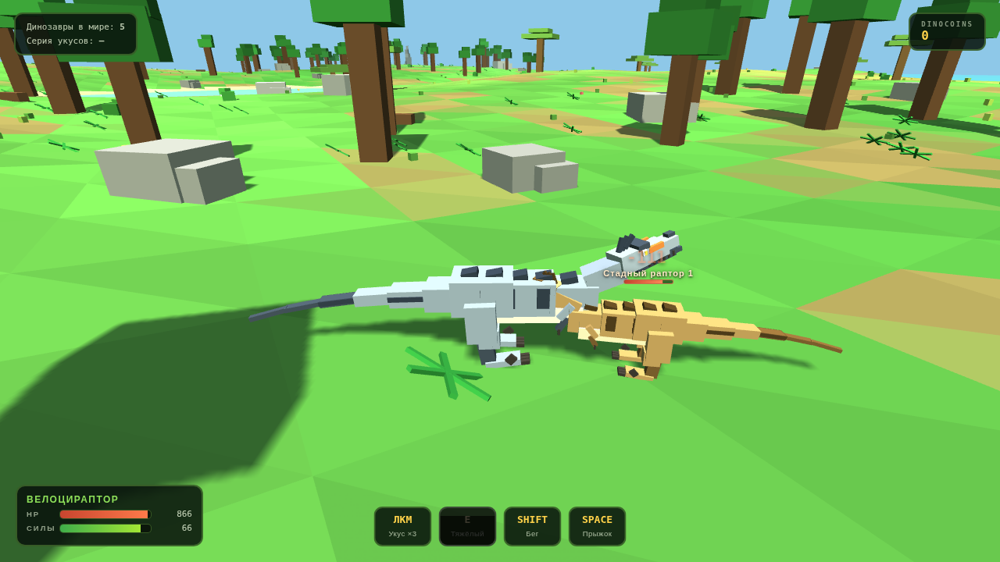

# 🦖 Jurassic Blocky

Блочная игра про динозавров в стиле Roblox-игры **Jurassic Blocky** — прямо в браузере, без установки.

## Как играть

Открой `jurassic_blocky.html` в любом браузере (лучше Chrome/Edge). Three.js подтянется с CDN, а если сети нет — сработает локальный фолбэк `three.r128.min.js` из этой папки.

## Управление

| Клавиша | Действие |
| --- | --- |
| **WASD** | движение |
| **Мышь** | камера (клик по экрану захватывает курсор) |
| **SHIFT** | бег (тратит силы) |
| **SPACE** | прыжок |
| **ЛКМ** | укус — серия из 3 комбо-ударов (можно удерживать) |
| **E** | тяжёлый удар с отбросом |
| **Колесо** | зум камеры |
| **ESC** | меню |

## Что на острове

- **Лагерь-спавн** в центре: частокол с воротами, палатки, костёр, ящики.
- **Меса с водопадом** на северо-востоке — с обрыва вода падает в пруд, из пруда течёт река к озеру.
- **Озеро с пляжем и палмами** на западе — в глубокой воде динозавр плывёт по поверхности.
- **Арена из гигантских костей** на юго-востоке — череп-врата и арка из рёбер.
- **Саванна и джунгли** с деревьями, папоротниками и брёвнами.
- **5 диких стадных рапторов**: настораживаются, убегают зигзагом и контратакуют, если прижать вплотную. За победу дают DinoCoins.

## Велоцираптор

Гладкий low-poly рельеф (без майнкрафт-кубиков), блочная модель в стиле Jurassic Blocky: горизонтальная посадка, зубчатый гребень на спине, полосатые бока, зигзаг зубов, серповидный коготь. Анимации привязаны к скорости — лапы не скользят: на шагу тело покачивается, на бегу стелется вперёд с работой хвоста, при жёстком приземлении динозавр приседает.

## Архитектура (задел под мультиплеер)

- Симуляция идёт фиксированным шагом **1/30 с** отдельно от рендера.
- Единый реестр сущностей `ENT` (игрок, NPC и будущие сетевые игроки — один формат).
- Ввод игрока собирается в интенты (`NET.emitIntent`) — при подключении socket.io они уйдут на сервер.
- Карта генерируется из детерминированного seed — сервер воспроизведёт её тем же кодом.

## Дорожная карта

1. ✅ Меню, велоцираптор, остров, бой с дикими рапторами
2. ⬜ Мультиплеер до 30 игроков (socket.io + снапшоты, как в Wings of Glory)
3. ⬜ Магазин за DinoCoins: скины и новые динозавры
4. ⬜ Мировые боссы и события
