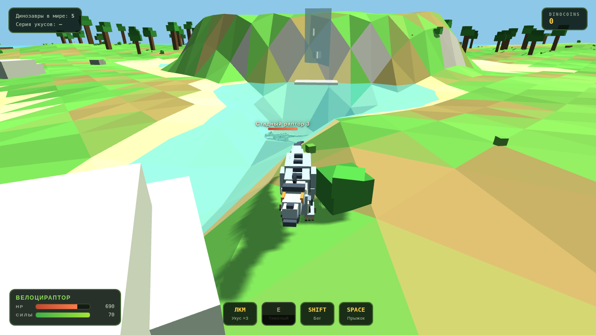

# 🦖 Jurassic Blocky

Блочная игра про динозавров в стиле Roblox-игры **Jurassic Blocky** — прямо в браузере, без установки.

**▶ Играть онлайн: https://corsalet.github.io/Jurassic-Blocky/**

## Как играть

**Онлайн:** открой https://corsalet.github.io/Jurassic-Blocky/ — игра запустится сама.

**Локально:** скачай `jurassic_blocky.html` и `three.r128.min.js` из репозитория и открой файл в браузере (лучше Chrome/Edge). Three.js подтянется с CDN, а если сети нет — сработает локальный фолбэк.

## Динозавры (выбор в меню — кнопки ‹ ›)

| Динозавр | Стиль | Приём Q |
| --- | --- | --- |
| **Велоцираптор** | быстрый засадный хищник | Захват: напрыгни, прижми жертву и грызи, пока держишь Q |
| **Трицератопс** | живой танк (2100 HP) | Таран: разгон, отбрасывает и оглушает всех на пути |
| **Тираннозавр** | царь ящеров (2600 HP) | Попрание: сотрясает землю, бьёт по площади вокруг |

## Управление

| Клавиша | Действие |
| --- | --- |
| **WASD** | движение |
| **Мышь** | камера (клик по экрану захватывает курсор) |
| **SHIFT** | бег (тратит силы) |
| **SPACE** | прыжок |
| **ЛКМ** | укус — серия из 3 комбо-ударов (можно удерживать) |
| **E** | тяжёлый удар с отбросом |
| **Q** | особый приём вида (см. таблицу выше) |
| **R** | отдых: быстрое лечение на месте (+7.5% HP/с); урон сбивает отдых |
| **Колесо** | зум камеры |
| **ESC** | меню |
| **P** | пауза |

## Что на острове

- **Лагерь-спавн** в центре: частокол с воротами, палатки, костёр, ящики.
- **Меса с водопадом**, джунгли, пляжи и озеро — остров в духе Jurassic Blocky.
- **Стадо диких рапторов** и **стада трицератопсов** — охоться, чтобы получать DinoCoins.
- **Дикий тираннозавр** — апексный хищник: сам охотится на того, кто подойдёт ближе 30 м. Не отступает.
- **Месть стада**: нападёшь на одного — остальные в округе переключатся на тебя (над злыми — знак ⚠).
- **Лечение**: вне боя здоровье восстанавливается само, а на месте по клавише R — быстрый отдых. NPC тоже отхиливаются, если их не добивать.
